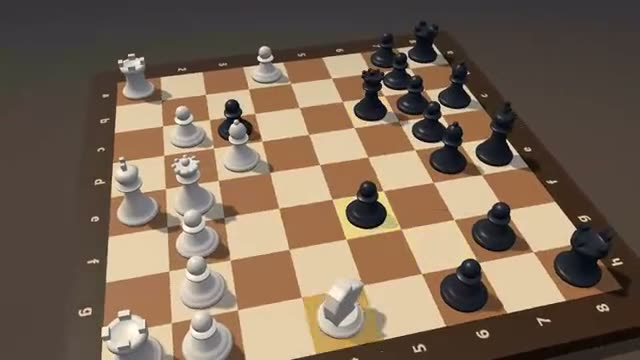

# Chess

Real chess on a 3D board. Illegal moves are refused. A multiplayer starter game from [Multiplayer Agent](https://multiplayeragent.com): 3D, turn-based, 2 players plus anyone who wants to watch, with a bot that takes any empty seat.

## How it plays

Standard chess with every rule: check, mate, castling, en passant, promotion and the draw rules. The first two players take the seats; anyone else watches. Alone? A bot plays the other side, and a friend who joins takes over from it.

**Controls:** Click or tap a piece, then one of its dots.

## Make it yours in the Game Builder

Open the [Game Builder](https://multiplayeragent.com), choose **Start from a starter game** and pick Chess. It opens as version 1 in your studio, ready to play and publish. Then ask for changes, for example:

- Add a 5-minute clock
- Add chat for people watching
- Make the pieces animals

## Run it yourself

1. Get a free publishable key (`pk_…`) at [multiplayeragent.com](https://multiplayeragent.com).
2. In `index.html`, put it in place of `pk_REPLACE_ME` in the `MP_CONNECT` block.
3. Serve the folder (for example `npx serve`) and open it. The 3D engine loads as a module, which browsers block from a file on disk.

Without a key it still runs, offline against the bot.

## How it is built

- One `index.html`, plus three.js in `libs/`. The comment at the top of the script maps the code and explains the multiplayer.
- **Host-run rules:** The host's browser checks every move; if it leaves, the next player takes over.
- **Bots:** A bot takes any empty seat, so you can play alone, and a friend who joins takes the bot's side.
- **Live sync:** Players and watchers see the same board; the game carries on if someone reloads while another player stays.
- **Leaderboard:** Most wins, shown after every game.
- `?attract` runs it offline, bot against bot. The preview video is recorded from it.

## License

MIT.
